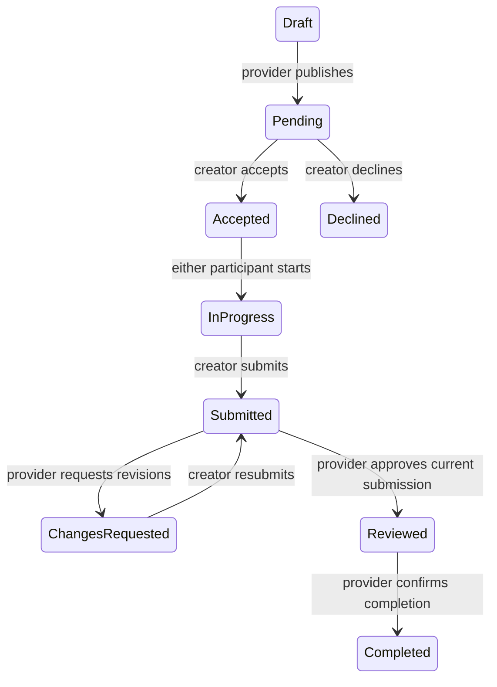

# Phase 3: creator collaboration backend

Continues existing `feature/creator-collaborations` / PR #26, reconciled without
history rewriting with approved development `81acf0e063fd046e85ed42dd0dd0a332f4e79d8e`.
The import conflict was resolved by retaining both approved Phase 2 privacy and
consent controls and the existing campaign service handlers. No creator module
was rebuilt and no frontend files were edited. The earlier draft report remains
historical; this document describes the completed backend scope.

## Audit and acceptance

| Requirement | Existing draft | Completed backend behavior |
| --- | --- | --- |
| Invitation | Transactional pending request | Private provider drafts, draft amendments, explicit publication or direct send |
| Requirements/compensation | Bounded text and type | Plain text, valid dates, frozen published offers, accepted terms snapshot and history |
| Lifecycle | Accepted -> submitted; approval completed immediately | Explicit progress, submitted/revision/review stages and separate provider completion for new version 2 |
| Roles/privacy | Participant mutation checks | Scoped detail/list reads, hidden unpublished drafts even after cancellation, safe populated account projections |
| Revisions | Optional expected revision | Retained compatibility; current submission ID required for version-2 review |
| Concurrency | Account locks; limited tests | Duplicate invitations, accept/decline, review races, global creation cap and atomic outbox rollback tested |
| Abuse limits | Bounded history/submissions | One active sent campaign per pair, 20 creations/provider/rolling 24h, block/availability checks |
| History/events | Audit entries and pending outbox | Contract snapshots, reasoned cancellation/revision, pending generic events in the same transaction |
| Queries | Unbounded owner lists | Stable pagination, status filter, summary lists and full-detail endpoint |

## Version-2 lifecycle

Either participant may cancel a nonterminal published campaign with a 10-1000
character reason. Only its provider controls an unpublished draft. Completed,
declined and cancelled campaigns cannot restart. A draft may also be cancelled;
it remains invisible to the proposed student and queues no recipient notice.

The existing `status` remains a compatibility summary: draft/pending -> pending;
accepted/in_progress/submitted/changes_requested/reviewed -> accepted; terminal
stages map to their names. **Use `stage` for the new workflow**, not status alone.
Direct creation publishes by default; `saveAsDraft: true` saves a private draft.
Drafts still require a complete valid proposal and an active opted-in creator.

Published campaign terms are immutable. A provider may replace terms only while
the record is a private draft, with every version retained in its audit history.
Publishing and acceptance snapshot those terms. To negotiate different published
terms, cancel and issue a revised invitation; an accepted campaign never silently
inherits a changed offer. Compensation types are paid, product_exchange,
experience and affiliate, with optional bounded proposal text. These are offers,
not verified remuneration, an enforceable payment guarantee or payment processing.

Optional deadlines accept an ISO timestamp with timezone or a calendar date
(calendar dates mean UTC midnight). Malformed/impossible dates and past deadlines
are rejected at proposal creation/edit; expired campaigns cannot publish or be
accepted. Accepted work may continue after its agreed deadline: submissions get
an `isLate` flag and require human review. Nothing auto-completes or auto-cancels.

## API and permissions

See [creator-collaborations.openapi.json](creator-collaborations.openapi.json).
All routes use full bearer sessions, persisted roles, active actors, no-store
responses and existing provider verification controls.

| Method and path | Actor | Behavior |
| --- | --- | --- |
| POST /api/promotion-requests | Verified provider | Create version-2 draft or sent invitation; 201 owner envelope |
| GET /api/promotion-requests/mine | Student | Own published summaries, excluding all unpublished drafts |
| GET /api/promotion-requests/provider | Verified provider | Own summaries including drafts |
| GET /api/promotion-requests/{id} | Owning participant | Full campaign, submissions, audit and accepted terms; unrelated reads are 404 |
| PATCH /api/promotion-requests/{id}/terms | Owning verified provider | Replace private draft terms; cannot retarget the student |
| PATCH /api/promotion-requests/{id}/status | Owning participant | Publish, accept/decline, start, complete or cancel under stage/role rules |
| POST /api/promotion-requests/{id}/submissions | Owning student | Bounded notes and up to six public references; no uploads/server fetching |
| POST /api/promotion-requests/{id}/review | Owning verified provider | Approve or request changes to the current submission ID |

Lists retain `data.requests` and add page/limit/total/pages. Defaults: page 1,
limit 20; maximum page 10,000, limit 50. Optional `status` accepts the existing
summary values. Sort is createdAt descending then unique ID descending. Full
history and submission arrays live in detail responses, not summaries. Counts
can change during concurrent edits; pagination is not a cross-request snapshot.
Existing clients need pagination controls to access records beyond the first page.

Account projections never return passwords, email, token versions or private
academic data. A public alias masks the legal name. If a creator withdraws
discovery, existing counterparties retain the relationship's name/alias, but its
current hidden portfolio is omitted and empty arrays preserve consumer safety.
Administrators have no automatic private-campaign read/update override.

Current account/provider checks occur inside mutations as well as middleware.
An active student can decline/cancel even when the counterparty is suspended,
deleted or unverified; those conditions do not trap the student in a commitment.
New invitations/drafts/publication honor opt-in, unavailability and either user's
block. Existing agreements survive a discovery opt-out; work still needs active
participants/current provider verification, while a reasoned exit remains possible.

## Transactional integrity and limits

Participant accounts are locked in stable ID order inside the existing replica-set
transaction pattern. Status, revision, submissions/history and recipient events
commit together, with automatic transaction retry on write conflicts. Pending
notification keys are unique per owner/campaign/revision. No email, push or in-app
delivery worker is introduced: **pending means stored, not delivered**. Generic
notices contain no proposal, evidence, compensation or private transcript text.

Creation is limited to 20 records per provider over a rolling 24-hour window,
including private drafts and subsequently declined/cancelled records. Closing a
request does not reset that allowance. At most one active sent campaign per
provider/student pair may exist; multiple private drafts may exist within the cap.
The provider lock protects both pair checks and quota checks under concurrency.
Existing active legacy records also count for duplicate prevention.

At most ten deliverable submissions and 100 audit entries are stored. Ordinary
actions stop at 99 history entries, reserving the final entry for an exit. At a
submission/activity limit, participants may need to cancel and issue a new
agreement; there is no unbounded append or automatic data deletion.

Expected `revision` remains optional, preserving existing accept/decline calls.
Clients should send it for conflict detection (409 on stale state). Version-2
reviews additionally require the latest `submissionId`; a stale or omitted ID
cannot approve unseen replacement work even when revision was omitted.

## Database, rollout and rollback

Reuses PromotionRequest and the draft's NotificationOutbox model. Additive fields
are workflowVersion=2, stage, publishedAt, accepted terms, historical terms and
submission lateness. New compound indexes support provider/student date-ordered
lists and provider quota queries. The outbox retains its unique owner/dedupeKey
index. No destructive migration, production account change or data backfill ran.

Legacy records without workflowVersion retain their previous accepted->completed
provider action if they have no submissions. Existing draft workflowVersion=1
retains submit-after-accept and review-approval completion. Read-time stage
derivation does not rewrite legacy records or invent old agreements/history.

Before production rollout, back up the relevant collections, inspect index build
costs and any existing outbox duplicate keys, and approve coordinated deployment.
Do not run destructive syncIndexes or rewrite historical records. Existing replica
set, majority-write and Phase 1 signing/CORS configuration requirements remain.
**Do not mix older campaign writers with version-2 writers**: old handlers do not
enforce new stages. Older artifacts cannot safely mutate new version-2 records.
Prefer a forward fix; if rollback is necessary, disable campaign writes until a
version-aware compatible backend is deployed. Preserve current records and audit
history; restoring an old database backup merely to undo application code would
lose later consent and agreement decisions.

Frontend implementation remains separate. The old completion button cannot
bypass version-2 submission/review; new progress, draft, review, detail/pagination
and completion controls need the separate UI workflow. No frontend editing was
performed here and this phase does not claim those screens exist.

## Verification

Unit tests exercise stage/role transitions, compensation/text validation,
deadline boundaries, legacy stage derivation and proposal snapshots. Real
Express/MongoDB integration tests cover complete new/legacy flows, private drafts,
quotas, duplicate prevention, wrong roles, stale reviews, simultaneous decisions,
rollback, privacy, list bounds, late work and exit availability. Tests use owned
disposable loopback replica sets with synthetic fixtures; normal Docker data and
accounts are untouched. Actual complete-suite counts and CI links are in PR #26.

Remaining work outside this phase: optional creator identity verification,
frontend controls and its existing dependency advisories, centralized notification
delivery, production operations/monitoring and later scholarship/resource phases.
