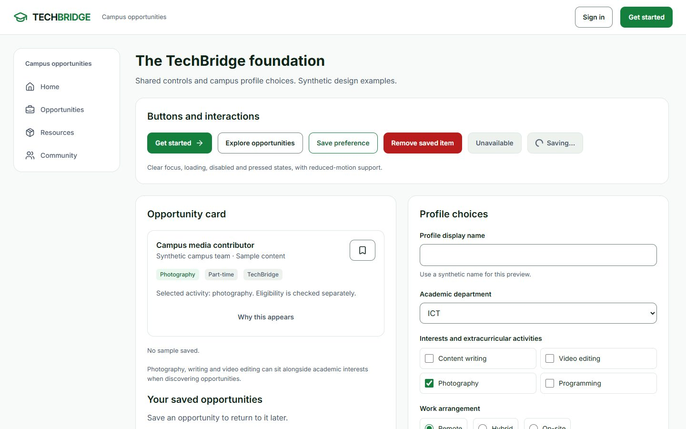
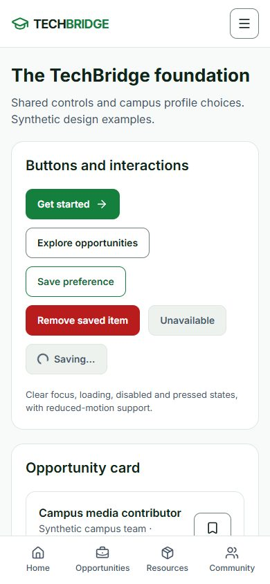

# Shared UI foundation — phase review

Branch: `design/ui-foundation`

Base: `024cc0e4abcee5b1bf0f8dc7058905a703e96564` (`development`, fetched 2 November 2026)

Status: implementation prepared for a separate pull request to `development`; merge requires owner approval.

## Problem and resulting behavior

The existing portal used a long, wrapped dark navigation bar, page-specific controls and inconsistent ownership of headers. Students, providers and administrators now share a white/green application shell, a desktop sidebar, a compact mobile menu and role-specific quick navigation. Existing API clients, roles, routes, guards and business rules are preserved.

The supplied actual-view board governs the forest/white/mint palette, graduation-cap wordmark, rounded controls and restrained interaction. The action fill is `#15803D`: normal white text measures 5.02:1 contrast, compared with 3.30:1 on the suggested `#16A34A` accent. This distinction was included in the approved preview.

## Implemented scope

- Shared buttons with explicit form behavior, variants, loading/repeat-click protection, disabled state, focus and reduced-motion behavior.
- Field composition that connects native controls to labels, help and validation errors without losing existing descriptions.
- Cards, status badges, error/success notices, loading skeletons and empty states.
- Controlled native dialogs with accessible titles, Escape handling, forward/reverse focus wrapping and focus return.
- Shared white header, role-aware desktop navigation, accessible mobile menu and four core quick destinations where appropriate. Pending providers receive verification/public links rather than publishing links. Public mobile navigation retains sign-in and registration actions.
- A skip link, scroll clearance for focused controls and reserved bottom-bar space.
- Header ownership moved into `PortalLayout`. The activity, provider dashboard/profile, resource-listing and community pages no longer render a second header. `/connections` retains its URL and public behavior inside the common shell.
- A lazy development-only `/design-system` gallery using the actual React controls. Its synthetic examples make no account/API writes and are excluded from the production bundle.

The foundation does not complete the remaining page redesigns, eleven-persona seed, managed image uploads or newer recommendation clients. Those remain separately reviewed phases. No database migration, schema, backend source, dependency manifest or lockfile changed.

## Preview

Start the frontend development server and open `/design-system` for the actual component gallery. This route is intentionally unavailable in production builds. The regular portal routes show the shared shell.

These are real browser captures of the development gallery. All identities/content in the gallery are explicitly synthetic; it is not a completed student dashboard or a real vacancy feed.

## Files and APIs

Application changes:

- `frontend/src/styles/foundation.css`, imported by `frontend/src/index.css`: scoped design tokens, controls, states and responsive shell styles.
- `frontend/src/components/ui/`: `Button`, `Field`, `Card`, `Feedback`, `Dialog` primitives.
- `AppHeader`, `PortalLayout`, new `WorkspaceNavigation` and `utils/workspaceNavigation`: one shell and existing authorized destinations.
- `App.tsx`: common-shell placement of the community route and lazy development-only gallery route.
- `pages/DesignSystemPage.tsx`: interactive examples of the real controls.
- `FacultyConnectionsPage`, `MyActivityPage`, `ProviderDashboardPage`, `ProviderProfilePage`, `ResourceListingPage`: remove redundant header imports/renders only.
- New unit/integration/E2E cases, this review and two gallery screenshots.

Existing APIs reused: session login/rehydration/logout behavior and all existing page clients. Navigation requests no new backend capability. Backend authorization remains authoritative; hiding or showing a link is not an authorization grant.

New API/database requirements for this phase: none. The later upload phase must retain the separation between private verification evidence and public profile assets.

## Executed validation

| Check | Result and scope |
| --- | --- |
| Frontend unit | 28 passed, including default/non-submit button behavior, explicit submission, repeat-action prevention, accessible descriptions, native choices, gallery validation, role/subtype navigation and active destinations |
| Frontend integration | 80 passed, including real AuthProvider/Axios/MSW session rehydration, logout, provider profile header ownership, admin navigation and unauthorized admin-route rejection |
| Full local Playwright regression | 17 passed after correcting the new dialog's Tab boundary behavior |
| Final focused Playwright | Latest source: foundation navigation and community-verification journeys; final execution recorded in the PR validation update |
| Development gallery browser check | Actual controls checked for form validation, sample saving, dialog Tab/Escape/focus return, reduced motion and no API writes at 320/390/768/1440px |
| TypeScript, ESLint and production build | Executed; final source results recorded in the PR validation update. Existing JavaScript chunk-size warning remains; no threshold was relaxed |
| Repository checks | 9 policy tests passed; no tracked environment files, dependencies or compiled output; whitespace check passed |
| Dependency audit | Frontend audit executed: 18 existing affected entries (12 moderate, 6 high), with manifests/lockfiles unchanged. This is not a production-security sign-off |

The complete regression run caught a real focus boundary problem in the new mobile dialog. The dialog was corrected to wrap focus in both directions, then all 17 journeys passed. No test timeout or authorization check was weakened. Subsequent small shell/gallery refinements received the final focused regression and CI run.

Fixtures and accounts tested:

- Browser: isolated ICT student, verified provider and administrator sessions; existing provider-verification and community-claim journeys remain in the full regression.
- Unit navigation contracts: ICT/ET/BST students; company, faculty, alumni and individual provider subtypes; pending provider; administrator; public visitor.
- ET/BST and provider-subtype navigation tests do not certify their complete role-specific journeys. The eleven-persona seed remains the next separately scoped foundation dependency.
- Existing normal local admin/student credentials were checked on the owner's request and both logged in successfully. The existing local provider was correctly denied full login pending verification. Passwords and tokens are not included in source, screenshots or this report; no normal account was created, promoted, approved or reset.

## Accessibility and visual review

Real Chromium checks cover 320, 390, 768 and 1440px, one header, no horizontal overflow in the tested public portal, menu focus containment/return, menu navigation, skip-link focus, session logout, role-specific destinations and reduced motion. Footer-link focus clearance is also checked against the fixed header and bottom navigation. These checks do not constitute a full screen-reader or WCAG conformance audit.

Visual inspection used the real React gallery at 1440/768/390 and examined all fold/contact-sheet images. There were three review rounds:

1. The first gallery had stretched panels with 242/178px blank bands. Controls, typography and contrast were consistent, but empty space weakened the comparison. Score: design 7, usability 7.5, creativity 7, content 7.5 → 7.2.
2. Intrinsic panel heights removed the blank bands but exposed uneven peer edges. Score: design 7.5, usability 8, creativity 7, content 7.5 → 7.6.
3. The saved-empty example now belongs with the opportunity example, and feedback states form their own full-width block. This balances useful content without fake metrics or filler. Final score: design 8, usability 8, creativity 7, content 8 → 7.8, subject to the inspector exception below.

The final raw inspector reports one `covered-text` heuristic at an intermediate mobile scroll position: the pre-existing footer wordmark passes behind the intentional fixed quick-navigation bar. The contact sheet shows the wordmark fully readable on the next fold. This exact footer-wordmark case is a documented exception to an all-scroll-position overlap heuristic, not an ignored contrast or focused-control failure. The supplied design explicitly calls for mobile bottom navigation. Raw reports were retained locally; no claim of zero raw inspector findings is made.

App-screen review: the gallery's largest heading identifies the design being reviewed; controls and related examples share consistent edges; color identifies actions/selection/status; no totals or match percentages are invented; no fake unread-count queues appear; there are no misleading chart legends; and phone navigation collapses to a menu plus quick destinations. The board was supplied by the user, so no random style or draw seed was used. The preview's light theme, green active navigation and soft rounded surfaces take precedence over generic style preferences.

## Known limits and next work

- Provider/resource page bodies still include pre-existing light text intended for an old dark theme. This phase changes their shell ownership; their detailed content redesign remains necessary.
- Recovery page routing, newer personalized recommendation integration, full creator lifecycle screens, mentor appointments, events and notifications remain on the UI roadmap.
- Existing frontend dependency findings and the production bundle-size warning remain; this phase introduces no dependency changes.
- The normal workspace's 49 pre-existing changed files were preserved byte-for-byte. Implementation was performed in a separate worktree, without switching/resetting the user's current checkout.

## Pull request and merge

Target: `development`. The branch is pushed for review after local verification. CI and the pull request URL are recorded in the phase handoff. No automatic merge or next-phase implementation is authorized by this report.

Please review the implementation, preview, and testing results. Do you approve merging this phase into development?
